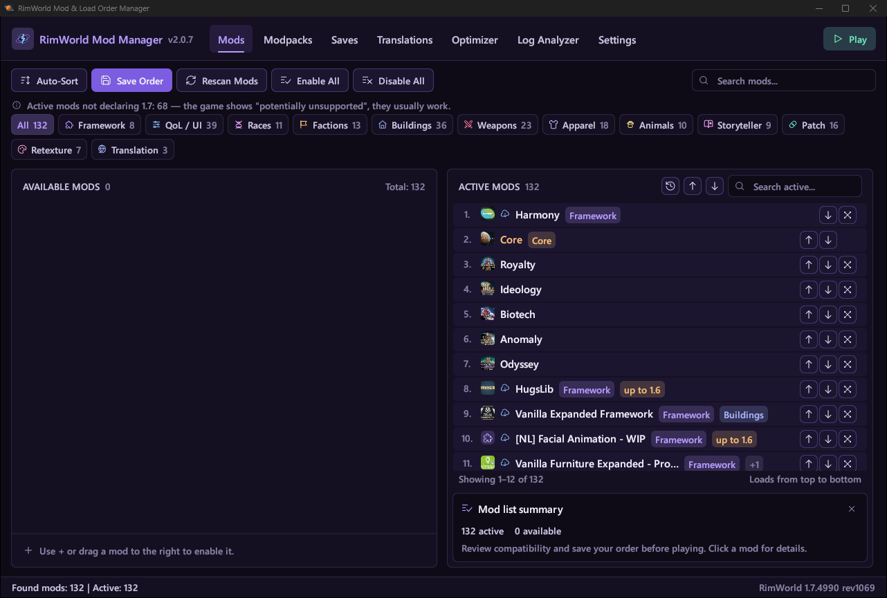

# RimWorld Mod Manager

**English** | [Русский](README.ru.md)

A mod and load order manager for RimWorld 1.6 (Unity) and 1.7 (Waylith). Written in Rust with an egui interface. Runs on Windows. The interface is available in English and Russian.



## Download

The ready-to-run program is in the **[Releases](https://github.com/Kansikoru/rimworld-mod-manager/releases/latest)** section of this repository. Download `rimworld-mod-manager.exe` and run it — no installation needed.

## Features

- **Mod list.** Enable and disable mods, move them (with the mouse too, one at a time or as a group), search, and filter by categories detected from each mod's content (races, factions, buildings, weapons, QoL and more). Warnings about dependencies, incompatibilities, copies of the same mod, and mods without support for the installed game version; a "No 1.7" filter.
- **Mod updates.** The "Updates" button compares installed mods with the Steam Workshop and marks the ones with a newer version (including "updated for this game version"). Without Steam, file dates are compared and the result is marked as an estimate.
- **Sorting.** Uses About.xml (dependencies, `loadAfter`/`loadBefore`, `*ByVersion` blocks) and the RimSort community rules database, which can be downloaded or imported from RimPy.
- **Saving ModsConfig.xml** with a backup. Mods that aren't on disk are kept when saving. The "Load order history" window brings back the order from any of the last 30 saves.
- **Modpacks.** Several mod lists to switch between: "Enable", "Enable and play", duplicate, rename. They are kept in the game's `ModLists` folder, so the game's own mod menu shows them too. Import an `.rml` or someone's `ModsConfig.xml`, export an `.rml`, copy a modpack as a list with Workshop links. Missing mods can be subscribed to with one button.
- **Saves.** For every save you can see which mods it was made with: what is enabled, what is disabled, what isn't on disk. "Enable as in the save" sets exactly its mods and order; the list can be kept as a modpack.
- **Translations.** Looks for translations of all active mods at once, in one of 13 popular languages: only translations whose title has the mod's name and the chosen language are shown; subscribe to the ticked ones with one button. You can also search for a single selected mod. Deleting the translations of the chosen language asks first and moves them to the Recycle Bin.
- **Texture optimizer** (1.6 and 1.7). Converts PNG/JPG to DDS: BC7 for textures with transparency, BC1 for the rest, with mipmaps. On 1.7 textures are stored the way the game expects them; "Flip textures" fixes ones converted for the other version. Every created file is logged, so a rollback removes them all. The game's texture cache can be reset too.
- **Log analyzer.** Reads Player.log in both formats (1.6 and 1.7), points at the mods to blame and prepares a question for an AI assistant.
- **Find the broken mod.** When the log doesn't point at the culprit: the program turns off half of the mods, you start the game and say whether the problem is still there — down to one mod (or a pair of mods that only break together). Dependencies are turned on with the mods, any step can be undone, and everything comes back at the end.
- **Game launch** with the right options for the installed version.
- **New versions.** Once a day the program checks GitHub for a new release and shows a badge next to the version. It never downloads anything by itself; the check can be turned off in Settings.
- **Your own layout.** Tabs you don't use (Modpacks, Saves, Translations, Optimizer) can be hidden in Settings; Log Analyzer and Settings can be shortened to an icon. The window shrinks down to 640×480: tabs and buttons turn into icons, and columns stack.

Settings, cache and backups are kept in `%LOCALAPPDATA%\RimWorldModManager`.

## Found a bug?

[Open an issue](https://github.com/Kansikoru/rimworld-mod-manager/issues/new?template=bug_report.yml) — the form asks for everything needed:

- what happened and how to reproduce it, step by step;
- the program's version and RimWorld's version;
- where the game is from: Steam, GOG or another copy without a launcher;
- screenshots, if you can — they help a lot;
- `crash_log.txt` from `%LOCALAPPDATA%\RimWorldModManager` if the program closed by itself.

**Only bugs of the program itself.** Conflicts between mods, game crashes and errors caused by mods aren't handled here — that's for the mods' authors. To find such a mod, use the **Log Analyzer** tab and **Find the culprit**.

## Building

Requires [Rust](https://rustup.rs/) 1.87 or newer.

```bash
cargo build --release
```

The program: `target/release/rimworld-mod-manager.exe`.

## Tests

```bash
cargo test
```

Checks that use the installed game have to be run by hand:

```bash
cargo test -- --ignored --nocapture
```

## Authors

- [Kansikoru](https://github.com/Kansikoru)
- [Anry2323](https://github.com/Anry2323)

## License

MIT — see [LICENSE](LICENSE).
