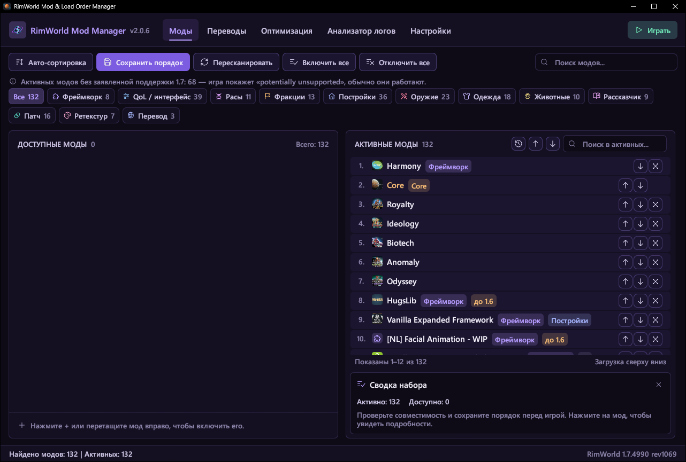

# RimWorld Mod Manager

[English](README.md) | **Русский**

Менеджер модов и порядка загрузки для RimWorld 1.6 (Unity) и 1.7 (Waylith). Написан на Rust, интерфейс на egui. Работает под Windows. Интерфейс на русском и английском.



## Скачать

Готовая программа лежит в разделе **[Releases](https://github.com/Kansikoru/rimworld-mod-manager/releases/latest)** этого репозитория. Скачайте `rimworld-mod-manager.exe` и запустите — установка не нужна.

## Что умеет

- **Список модов.** Включение и выключение, перемещение (в том числе мышью, по одному или группой), поиск, категории по содержимому мода (расы, фракции, постройки, оружие, QoL и т.д.) с фильтром. Предупреждения о зависимостях, несовместимостях, копиях одного мода и модах без поддержки текущей версии игры; фильтр «Без 1.7».
- **Обновления модов.** Кнопка «Обновления» сверяет установленные моды со Steam Workshop и отмечает те, у которых вышла версия новее (в том числе «обновлён для этой версии игры»). Без Steam — по датам файлов, с пометкой «оценка».
- **Сортировка.** Учитывает About.xml (зависимости, `loadAfter`/`loadBefore`, блоки `*ByVersion`) и базу правил сообщества RimSort, которую можно скачать или импортировать из RimPy.
- **Сохранение ModsConfig.xml** с бэкапом. Моды, которых нет на диске, при сохранении не теряются. В окне «История» можно вернуть порядок из любого из 30 последних сохранений.
- **Сборки.** Несколько списков модов, между которыми можно переключаться: «Включить», «Включить и играть», копия, переименование. Хранятся в папке игры `ModLists`, поэтому видны и в меню модов самой игры. Импорт `.rml` и чужого `ModsConfig.xml`, экспорт `.rml`, копирование списком со ссылками Workshop. Для недостающих модов — подписка одной кнопкой.
- **Сохранения.** Для каждого сейва видно, с какими модами он сделан: что включено, что выключено, чего нет на диске. «Включить как в сейве» ставит ровно его моды и порядок; список можно сохранить как сборку.
- **Переводы.** Поиск переводов сразу для всех активных модов на одном из 13 популярных языков: показываются только переводы, в названии которых есть название мода и выбранный язык; подписка на отмеченные одной кнопкой. Можно искать и для одного выбранного мода. Удаление переводов выбранного языка — с подтверждением и в Корзину.
- **Оптимизатор текстур** (1.6 и 1.7). PNG/JPG конвертируются в DDS: BC7 для текстур с прозрачностью, BC1 для остальных, с мипмапами. На 1.7 текстуры сохраняются в той ориентации, которую ждёт игра; «Перевернуть текстуры» исправляет конвертированные для другой версии. Все созданные файлы записываются в журнал, поэтому откат удаляет их полностью. Есть и сброс кэша текстур игры.
- **Анализатор логов.** Разбирает Player.log обоих форматов (1.6 и 1.7), ищет моды-виновники и готовит текст запроса для ИИ.
- **Поиск сломанного мода.** Когда лог не указывает на виновника: программа выключает половину модов, вы запускаете игру и отвечаете, осталась ли проблема, — и так до одного мода (или пары модов, которые ломаются только вместе). Зависимости включаются вместе с модами, любой шаг можно отменить, в конце всё возвращается.
- **Запуск игры** с параметрами под нужную версию.
- **Новые версии.** Раз в день программа проверяет релизы на GitHub и показывает плашку рядом с версией. Сама ничего не скачивает; проверку можно выключить в настройках.
- **Интерфейс под себя.** Ненужные вкладки («Сборки», «Сохранения», «Переводы», «Оптимизация») можно скрыть в настройках, «Анализатор» и «Настройки» — сократить до значка. Окно сжимается до 640×480: вкладки и кнопки становятся значками, колонки встают друг под другом.

Настройки, кэш и бэкапы хранятся в `%LOCALAPPDATA%\RimWorldModManager`.

## Сборка

Нужен [Rust](https://rustup.rs/) 1.87 или новее.

```bash
cargo build --release
```

Готовая программа: `target/release/rimworld-mod-manager.exe`.

## Тесты

```bash
cargo test
```

Проверки на установленной игре, их нужно запускать вручную:

```bash
cargo test -- --ignored --nocapture
```

## Авторы

- [Kansikoru](https://github.com/Kansikoru)
- [Anry2323](https://github.com/Anry2323)

## Лицензия

MIT — см. [LICENSE](LICENSE).
